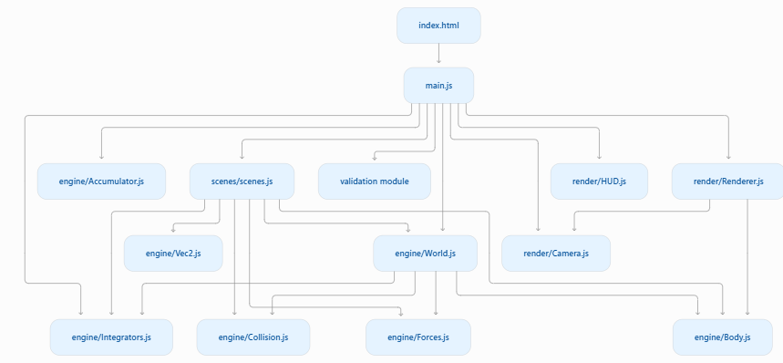
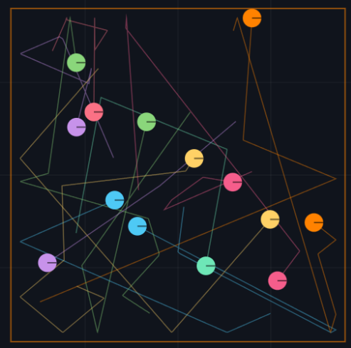
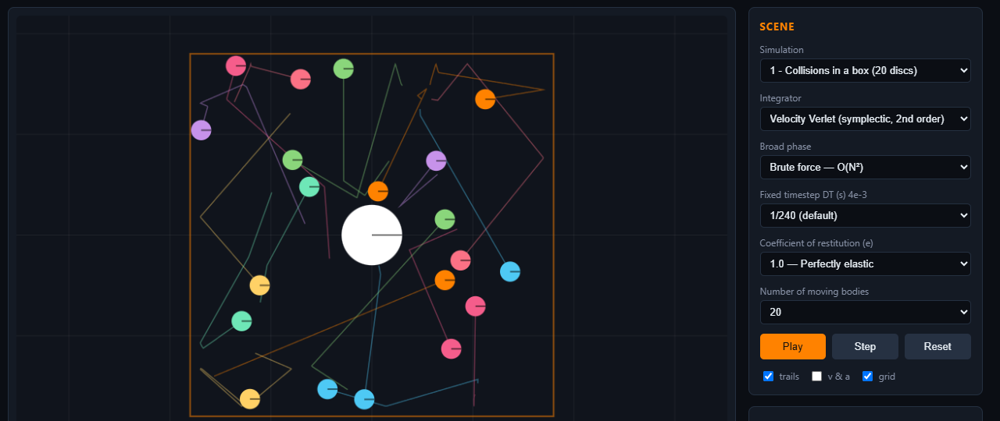
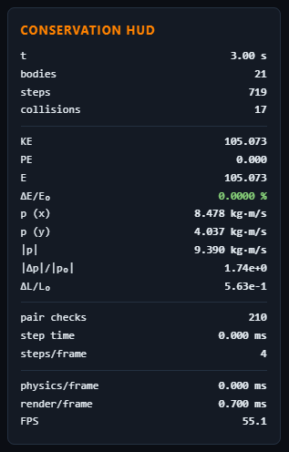
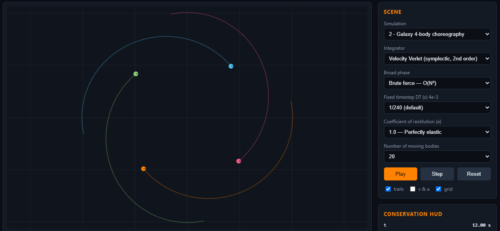
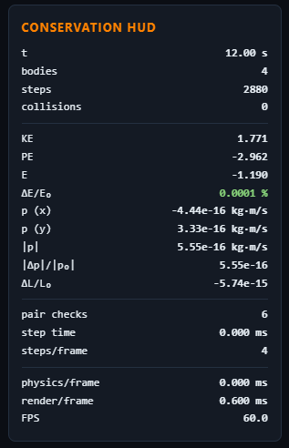
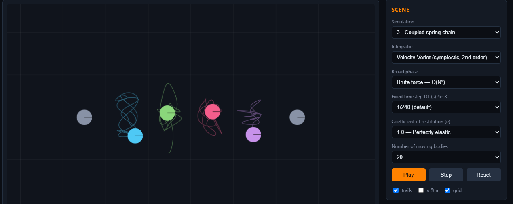
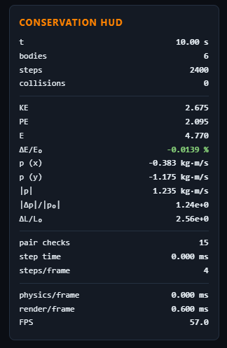
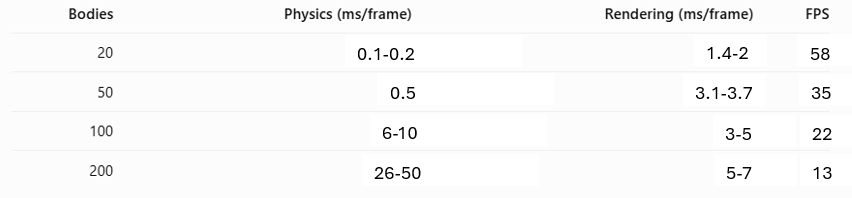

**A module dependency diagram (ASCII, Mermaid, or a photo of a sketch):**

**Jitter-bug demonstration + explanation (B1)**

The vn > 0 guard prevents the collision solver from applying an impulse when two overlapping bodies are already moving apart. Without it, the solver applies an unnecessary impulse that can reverse their motion and cause repeated bouncing or jittering. The guard ensures that impulses are applied only when bodies are approaching each other, while positional correction separately resolves any overlap.

**Momentum and energy test results, all three conditions (B2)**
No external forces (no gravity), e = 1, and 20 balls in a box. Total momentum must stay constant to round-off through hundreds of collisions. Report |p| at t = 0 and t = 60 s.

|p| is 7.097 kg-m/s at t = 0 and at t = 60, |p| = 10.616 kg-m/s.

Momentum changes due to the walls exerting impulse forces on the bodies.

E_total is 105.073 at t = 0  and t = 60. A fractional drift of 0%.

For e = 1:

E_total is 105.073 at t = 0 and 1.426 at  t = 60. A fractional drift of -98.6425%.

At e = 1, collisions are perfectly elastic, so both momentum and kinetic energy are conserved. At e = 0.8, collisions are inelastic, meaning some kinetic energy is converted into heat, sound, and deformation, causing the system's kinetic energy to decrease. Momentum remains conserved because the internal collision forces are equal and opposite, so they do not change the total momentum of the isolated system.

**One screenshot per scene with the HUD legible (C)**

*Scene 1*

*Scene 2*

*Scene 3*

**The performance scaling table + bottleneck analysis (C)**

Physics time grows faster than rendering time, meaning that the bottleneck most likely is coming from the collision detection in the code. Which is consistent with the prediction from the lesson.

My machine can only sustain 60 fps at 20 bodies.

**Honest note on any engine changes a scene forced**
The only change I made to the engine is in the NewtonianGravity softening variable. I changed it from 0 to 0.02, as only one scene was using that force, and the variable did not need to be implemented to be variable or a user selection.