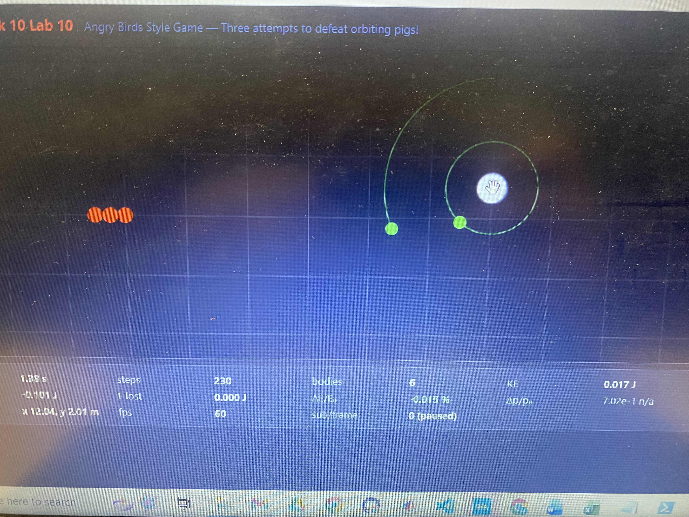
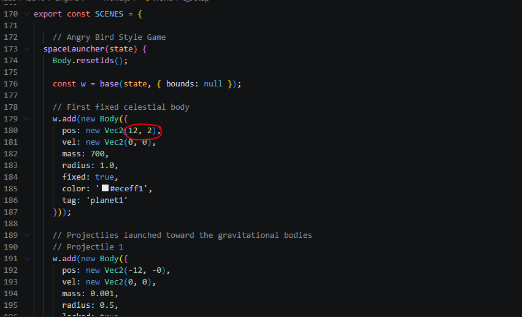

***Physics 311 — Simulation Testing and Evaluation Report***

**A1 — Coordinate-correct input**

These two pictures verify that the coordinate of the cursor matches the actual coordinate system through verification of the planets body position.

**A3 — Timestep Slider Stability Justification**
The timestep slider was restricted to a range of 0.001–0.020 seconds to maintain numerical stability while allowing the user to adjust the simulation's temporal resolution. The stability of the simulation was evaluated using attached masses ranging from 0.9 kg to 1.8 kg. Both mass limits were tested to determine whether the selected timestep range could handle the different configurations.

At both mass limits, the simulation remained stable, including when the pigs orbited the planet. Neither configuration caused the orbiting pigs to collide with the planet's surface. These observations support the selected timestep range as a practical operating range for the tested conditions. The upper limit of 0.020 seconds allows the simulation to run efficiently while retaining stable motion in the tested scenarios.

The slider also allows smaller timesteps when greater numerical precision is desired. Smaller timesteps provide more frequent physics updates, improving the resolution of the simulated motion at the cost of additional computation.

**B1 — Teleport-Drag Analysis**
The teleport-drag interaction was evaluated to determine how directly repositioning a body affects collision detection and momentum transfer. Unlike normal physical movement, teleporting changes an object's position without calculating the forces or motion that would ordinarily move it there.

Two specific failure modes were identified:

1. Collision tunneling: If a body is teleported from one side of another body to the opposite side, it can pass through the stationary object without the simulation detecting a collision. This happens because the collision detector checks the resulting positions rather than the path traveled between them.

2. Missing collision impulse: Because teleportation does not calculate the velocity or impulse associated with the movement, the bodies do not exchange momentum as they would during a physical collision. An object can be repositioned through another object without producing the expected change in velocity.

These failures demonstrate why direct position changes should not be treated as physical movement. Teleportation is useful for repositioning objects, but continuous collision detection or velocity-based movement is necessary when realistic collision behavior is expected.

**B2 — Visualization Features**
Three visualization options were implemented to make the physical behavior of the simulation easier to interpret: velocity vectors, force vectors, and motion trails. Each visualization can be enabled or disabled independently.

1. Velocity vectors
Velocity vectors display the instantaneous velocity of each body. The direction of each arrow indicates the direction of motion, while its length represents the relative magnitude of the velocity.

What this reveals: Velocity vectors make it possible to identify the direction and relative speed of moving bodies, particularly when observing orbital motion or projectile trajectories.

2. Force vectors
Force vectors display the net force acting on each body. The direction of the arrow indicates the direction of the resultant force, while its length represents the relative magnitude.

What this reveals: Force vectors show how gravitational attraction and other applied forces influence the motion of the bodies. They help explain changes in velocity and the curvature of orbital trajectories.

3. Motion trails
Motion trails display the recent paths traveled by the bodies. These trails make it possible to observe trajectories without having to follow each moving object continuously.

What this reveals: Motion trails show the shape and curvature of trajectories, making it easier to identify orbital motion, projectile paths, and changes in movement over time.

Together, these three visualizations provide complementary information. Velocity vectors show how objects are moving, force vectors show what influences their motion, and motion trails show the paths they have followed.

**B3 — Accessibility Report**
Accessibility was considered through both keyboard interaction and the use of standard interface controls. The simulation includes labeled controls, keyboard input, and a live status region to communicate changes in simulation state.

The canvas supports keyboard focus through its tabindex attribute and includes an accessible label describing its purpose. Keyboard controls allow users to interact with the simulation without relying entirely on a mouse. The interface also uses native HTML buttons, sliders, and selection controls, which support standard keyboard navigation.

A screen-reader status region was included using role="status" and aria-live="polite". This allows important state changes to be announced without forcibly moving the user's focus.

An unplugged-mouse test was included in the accessibility evaluation. The intended test is to disconnect the mouse and verify that the user can navigate the controls, adjust simulation settings, pause and restart the simulation, and interact with selectable bodies using the keyboard. The keyboard controls and focusable interface elements provide the necessary support for this interaction.

**Part C — Angry Birds-Style Physics Game**
Purpose
The purpose of Part C was to apply the physics engine developed throughout the project to an interactive Angry Birds-style game. The game uses a slingshot mechanic to launch projectiles toward target objects. The simulation calculates the resulting motion and collisions using the same physics engine components used in the other simulation scenes.

The objective was to demonstrate that the engine could support an interactive application while maintaining physically meaningful behavior.
Physics Topics
Two primary physics topics were incorporated into the game.

1. Projectile motion and Newton's second law

The projectile's motion is determined by its initial launch velocity and the forces acting on it. After being launched, the projectile follows a trajectory determined by its acceleration and velocity. Gravity influences its vertical motion, while the initial launch velocity determines its direction and range.

Newton's second law provides the foundation for calculating the projectile's acceleration from the net force acting on it.

2. Collision dynamics and impulse

When a projectile strikes a target, the collision system detects the contact and calculates the resulting changes in velocity. The collision response uses an impulse-based approach, with the coefficient of restitution controlling how much relative velocity is retained after impact.

This allows the game to represent different collision behaviors, from highly elastic impacts to collisions with significant energy loss.
Application of the Physics Engine
The game uses the existing physics engine to handle body movement, force calculations, and collision responses. The slingshot provides the initial launch conditions, while the engine determines the subsequent projectile trajectory and interactions with the targets.

The game also incorporates visual feedback through the simulation renderer, allowing users to observe the movement of projectiles and targets as the physics calculations are performed.

The implementation demonstrates how the same physics engine can be reused for an interactive application rather than being limited to isolated physics demonstrations.
Robustness Testing Log
The interface was tested by repeatedly interacting with controls to identify unexpected behavior or failures.

Test ->	Observed result:
Repeated restart clicks	-> No failure observed. The simulation continued to restart correctly.
Repeated pause clicks	-> No failure observed. The simulation continued to respond correctly.
Rapid changing G slider -> Failure observed. Pigs could gain enough velocity to escape the planet.
Timestep at 0.001 sec   -> Simulation remained stable in the tested configuration.
Timestep at 0.020 sec   -> Simulation remained stable in the tested configuration.
